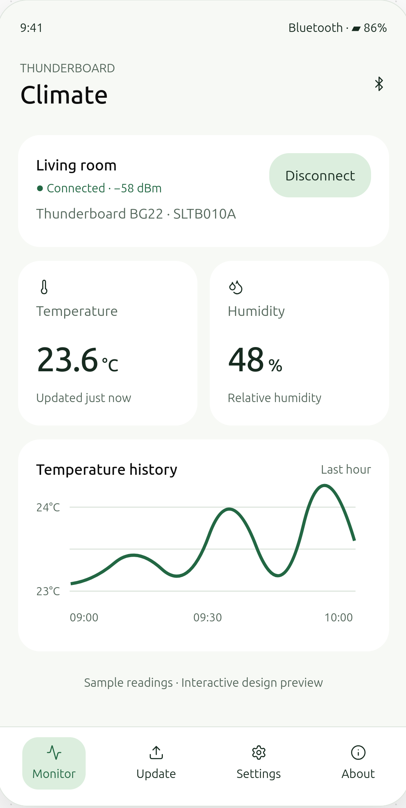

# James's Thunderboard for Android

A Kotlin Android interface for Pixel 7 and other Android 12+ phones, based on the
proposed Climate design. The existing Java BLE operation queue, sensor decoder,
and OTA package validator are reused. There are no third-party UI libraries and
no internet permission.

## Main screen reference



*This is the supplied proposed design with sample readings, not an on-device
screenshot.* The implemented app uses **James's Thunderboard** branding, live
session data, and explicit unavailable states for unsupported firmware features.

## Screens

- **Monitor**: scan and connect, disconnect, live temperature and humidity,
  stale-reading indication, manual refresh, and temperature history for the last
  hour. The green and white cards follow the design reference. Discovered signal
  strength is labelled as such; it is not represented as a continuously polled RSSI.
- **Update**: installed firmware version, Android document picker, validated
  `.bg22ota` package details, confirmation, transfer progress, and reconnect/version
  verification. OTA remains experimental; see the
  [hardware validation record](../firmware/VALIDATION.md).
- **Settings / Configure**: a per-board friendly name stored on this phone,
  reporting period from 1 to 3,600 seconds with acknowledged write and readback,
  and a keep-screen-on preference. The latter takes effect while connected;
  firmware updates always keep the screen on.
- **About**: board, sensor, app version, supported capabilities, and data behavior.

History contains actual received readings only. It stays in memory while the
activity is alive, uses monotonic timestamps, holds at most 3,600 readings, and
expires readings after one hour. Rotation keeps the existing activity, connection,
and history. A different board clears the trace; disconnects and stale gaps break
the line. The app does not collect readings through a background service or
persist history across process restarts.

## Firmware-dependent features

| Requirement | App behavior with current repository firmware |
| --- | --- |
| Temperature and humidity | Reads and subscribes to `181A / 2A6E / 2A6F` |
| Discovery | Scans for the advertised Environmental Sensing service |
| Battery | Shows unavailable; firmware does not expose Battery Service |
| OTA | Uses the existing experimental Silicon Labs OTA workflow |
| Device settings | Reporting period supported by firmware 4+; label is local |
| Sleep and reboot | Disabled with explanation; firmware has no such commands |

If a compatible firmware exposes the standard readable Battery Level
characteristic (`180F / 2A19`), the app reads it on connection and on **Read now**.
A missing, invalid, or rejected battery value shows unavailable. A standard battery
value is never substituted with the phone battery, RSSI, or an estimated value.
Sleep/reboot require a deliberate firmware protocol extension before they can be
enabled. No arbitrary control writes are sent to the existing board.

The reporting period is read on connection. Applying a setting writes with a
response and reads back the accepted value. Older firmware still supports sensor
monitoring. A board restart restores the 2-second default; no flash write is made.

## Build and install

Use JDK 17 or 21, Android SDK platform 34, and build tools 34.0.0. Configure
`local.properties` with `sdk.dir=/path/to/Android/Sdk` or set `ANDROID_HOME`.
Gradle 8.14.3, Android Gradle Plugin 8.6.1, and Kotlin 2.1.20 are pinned.

```bash
./gradlew --no-daemon assembleDebug lintDebug
adb install -r app/build/outputs/apk/debug/app-debug.apk
```

The app remains named **BG22 Monitor** on the launcher, preserving the existing
application ID and installation. Its Kotlin screens show **James's Thunderboard**.
Only Nearby Devices permissions are requested, following
[Android's BLE permission model](https://developer.android.com/develop/connectivity/bluetooth/bt-permissions).
Kotlin and Java coexist using the
[Kotlin Android plugin](https://developer.android.com/kotlin/add-kotlin).

## Verify on Pixel 7

1. Enable **Developer options → USB debugging** on the Pixel, connect it by USB,
   accept the debugging prompt, and confirm `adb devices` lists it. Install the APK
   with the command above. Open **BG22 Monitor** and grant Nearby Devices. Scan, select the board, and confirm
   both readings arrive. Turn Bluetooth off or remove board power and check that
   connection/stale status reflects this. Reconnect and verify chart gaps.
2. Visit every tab while connected and rotate the phone. Check that the connection
   and history remain, that long text scrolls, and that large Android font sizes
   leave controls accessible.
3. In Settings, apply 5 seconds and confirm readback and notification cadence.
   Reject 0, 3601, and empty input. Save a friendly name, reconnect to the same
   board, and check the name. Restart the board and confirm its 2-second default.
4. Check battery says unavailable on current firmware and sleep/reboot stay
   disabled. On firmware with Battery Service, check its reported value after
   connecting and after **Read now**.
5. Select an invalid update file; check rejection and that monitoring still works.
   On a provisioned test board, select a real `.bg22ota` and test OTA with USB
   recovery available. Success requires a matching version after reconnection.
   Never install the synthetic protocol-test fixture.

## Validation status

The Kotlin version 1.2 APK builds with `assembleDebug` and passes `lintDebug`
(with nonfatal warnings). Portable protocol tests pass, including battery values
0–100 and rejection of malformed/unavailable values. The new Kotlin UI has not
yet been installed or visually verified on a Pixel in this session; no device was
connected through ADB. Earlier sensor/reporting-period hardware results remain in
the [firmware validation record](../firmware/VALIDATION.md).

Portable protocol tests in `tests/ProtocolTest.java` cover battery and sensor decoding,
reporting-period validation, package metadata, checksums, and corrupt images.
See the [project README](../README.md) for provisioning and OTA limitations.
